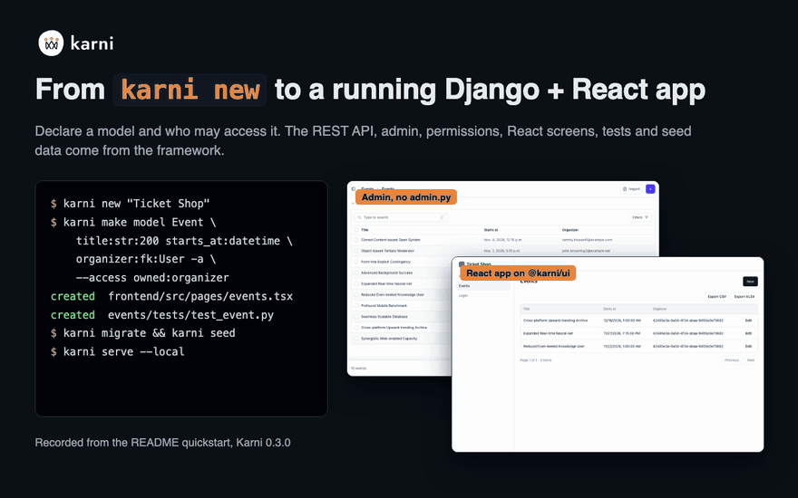
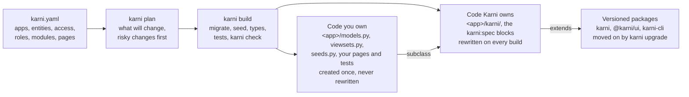

<p align="center">
  <picture>
    <source media="(prefers-color-scheme: dark)" srcset="https://raw.githubusercontent.com/cbsshekhawat18-lab/karni/main/assets/brand/karni-horizontal-dark.svg">
    
  </picture>
</p>

<p align="center">
Karni is an open-source Django + React framework for building with AI coding agents. Your agent writes only your domain. The API, admin, permissions and React screens come from a package you upgrade, not code it rewrites in each project. One rule set covers every coding agent. The build fails when an agent hand-writes what Karni ships.
</p>

<p align="center">
  <a href="https://pypi.org/project/karni/"></a>
  <a href="https://www.npmjs.com/package/@karni/ui"></a>
  <a href="https://github.com/cbsshekhawat18-lab/karni/actions/workflows/ci.yml"></a>
  <a href="https://cbsshekhawat18-lab.github.io/karni/"></a>
  <a href="https://github.com/cbsshekhawat18-lab/karni/blob/main/LICENSE"></a>
  <a href="https://pypi.org/project/karni/"></a>
  <a href="docs/faq.md#which-python-django-and-react-versions-does-karni-support"></a>
</p>

<p align="center">
  <b><a href="#quickstart">Quickstart</a></b> &nbsp;·&nbsp;
  <b><a href="https://cbsshekhawat18-lab.github.io/karni/">Docs</a></b> &nbsp;·&nbsp;
  <b><a href="docs/recipes/index.md">Recipes</a></b>
</p>

<p align="center">
  <!-- live-demo-link -->
  <a href="https://render.com/deploy?repo=https://github.com/cbsshekhawat18-lab/karni"></a>
  <br>
  The <a href="docs/demo.md">shop demo</a>: the shop recipe as one service, with a public demo login and a daily reset.
</p>

## Why Karni exists

Every web project starts with the same work: sign-in, a user model, the admin, permissions, CRUD endpoints, tables, forms, Docker and Celery. Only after that does the work on the product begin.

Coding agents write that setup faster, but they write it again in every project. Each copy is a little different, with the hard parts wrong in different places, and every copy has to be maintained. Karni grew out of the 34 projects we built before it.

## What is Karni

**The problem.** Every Django + React project needs the same code before it does anything of its own: serializers, permission classes, admin files, sign-in pages, tables and forms. A boilerplate copies it once. A coding agent writes it again in every project. Either way, a fix made upstream never reaches the copies.

**How Karni solves it.** That code ships as versioned packages: `karni` (Python), `@karni/ui` (React) and the `karni` command. `karni upgrade` moves a project to each new release, so a fix reaches every project that depends on Karni.

**What you get.** You declare a model and who may access it. Karni gives you the REST API, the admin, role-based access, the React screens, the tests and the demo data.

**What you still write.** Your domain: your models, the rules for who may do what, and the logic and pages your product needs. AGENTS.md tells the agent the same, and `karni check` fails the build when it hand-writes what Karni ships.

## Build an app from one line

1. **Create a project** with `karni new "Yoga Studio"` and open it in your coding agent.
2. **Describe the app in one line** after `/new-app`. AGENTS.md tells the agent what that asks for.
3. **The agent writes `karni.yaml`** from the closest [recipe](docs/recipes/index.md), and asks you only the questions `karni plan --questions` lists.
4. **`karni build` makes the app**: it adds the modules, writes Karni's code, migrates, seeds the demo data the spec asks for, generates the TypeScript types, and runs the tests and `karni check`.
5. **The agent writes only the domain logic that is left**, in the project's own files. It is done when `karni check` and `karni test` pass.

```text
/new-app a booking app for a yoga studio, with online payments
```

What the agent runs, from a real session:

```text
$ karni recipes list --match "a booking app for a yoga studio, with online payments"
booking   4  Booking: Resources with time slots that members book and pay for, never over capacity. (matched: booking)
shop      3  Online shop: Products in categories, a cart, orders and checkout with online payments. (matched: online, payment)

$ karni plan --questions
No questions: karni.yaml settles everything Karni asks before a build.

$ karni build
plan        22 changes, 0 risky: modules 1, features 1, roles 3, apps 1, entities 3, access 3, pages 3, migrations 1, seed 3, tests 3 (--verbose lists each)
modules     karni add payments
files       27 written: 17 Karni's, 10 the project's (pyproject.toml, frontend/package.json, ...)
migrations  bookings/migrations/0001_initial.py
migrate     applied 84 on default
seed        Resource 4, Slot 30, Booking 60 (demo login demo@example.com / karni-password)
types       frontend/src/api/types.ts and hooks.ts
test        7 passed in 2.88s, tests/openapi.snapshot.json updated (the API changed: commit it)
check       ok
Built: the project matches karni.yaml.
```

On a developer laptop, `karni new --recipe shop` builds the shop from scratch on SQLite in 14.1 seconds, its tests and `karni check` included and the frontend install left out ([how fast is it](docs/recipes/index.md#how-fast-is-it)). The flow works without an agent too: every step is a command you can run yourself. The recording below builds a project command by command, then shows its welcome page, its admin and its React screens.

<p align="center">
  
</p>

## Coding-agent benchmark

A coding agent built three small apps (a booking app with payments, a CRM with three roles and import, and a shop with orders and refunds) on plain Django + React and on Karni, with the same model, agent version, prompt and API contract. The harness's own acceptance tests decide success.

### What the agent built

One kept run per app and side, each passing every acceptance test, on the Karni 0.5.0 release. Both sides are measured the same way, by the project's own Django and its files (`scripts/benchmarks/tokens/inventory.py`):

<!-- bench:inventory:start -->
| In the finished app | Plain Django + React | Karni |
|---|---|---|
| API operations (route and method) | 22 to 25 | 71 to 135 |
| Sign-in and account endpoints, outside the admin | 1 to 2 | 16 |
| Models in the admin | 1 to 2 | 26 to 30 |
| React screens | none | 9 to 12 |
| Tests the project ships with | none | 7 to 15 |
| OpenAPI schema served | no | yes |
| Typed API client in the frontend | no | yes |
| Production Docker stack | no | yes |
| Rules for the coding agent | no | yes |
<!-- bench:inventory:end -->

**Why a Karni run costs more.** These tasks check only a small API contract. Plain Django meets it and stops there: no screens, no tests, and two sign-in endpoints at most. With Karni, the same request ends in the whole app above, and the agent also reads Karni's rules and runs its build and checks. So a Karni run costs more and takes longer (below), and for that the app has about 3 to 5 times the API operations, a full sign-in, an admin, React screens and tests.

### What it cost

45 runs: five per app on plain Django + React, on the Karni 0.5.0 candidate, and on Karni after the work on its agent flow.

<!-- bench:readme:start -->
| Task | Plain Django + React | Karni 0.5.0 candidate | Karni after the agent-flow work |
|---|---|---|---|
| Booking with payments | $0.19, 61.76 s, 5 of 5 passed, 5 tool calls | $0.45, 208 s, 3 of 5 passed, 26 tool calls | $0.33, 187 s, 5 of 5 passed, 20 tool calls |
| A CRM with three roles and import | $0.21, 70.51 s, 5 of 5 passed, 6 tool calls | $0.56, 278 s, 5 of 5 passed, 31 tool calls | $0.40, 236 s, 5 of 5 passed, 22 tool calls |
| A shop with orders and refunds | $0.23, 72.21 s, 5 of 5 passed, 7 tool calls | $0.62, 238 s, 4 of 5 passed, 29 tool calls | $0.44, 255 s, 4 of 5 passed, 24 tool calls |
| All three tasks | $0.63, 204 s, 15 of 15 passed, 18 tool calls | $1.63, 724 s, 12 of 15 passed, 86 tool calls | $1.17, 678 s, 14 of 15 passed, 66 tool calls |

Each cell: median cost in US dollars, median wall time, runs that passed every acceptance test, and median tool calls. In the last row the runs add up and the other figures are the sums of the task medians, as the [benchmark report](docs/benchmarks/tokens.md) gives them.
<!-- bench:readme:end -->

- **Plain Django + React was cheaper and faster on these three small apps.** Karni after the agent-flow work cost about 1.8 to 1.9 times as much per app (median) and took about 3 to 3.5 times as long.
- **The agent-flow work** cut the median cost by 27 to 30 percent and the context the agent read again by 30 to 43 percent, and raised the runs that passed every test from 12 of 15 to 14 of 15.
- **With Karni the agent wrote fewer lines of its own** (median 256 to 431 per app, against 438 to 554), and each Karni project ended with far more code in it (median about 11,500 to 20,000 lines, most of it generated by Karni, against about 440 to 570).

**Not counted here: setting up.** Both sides started from a ready-made project; the harness, not the agent, made plain's Django and React starting point. Without Karni, that setup is done again for every new project. With Karni, `karni new` does it, and builds what the first table shows, with no AI tokens. A benchmark that starts from an empty folder and a one-line request is next.

The [benchmark report](docs/benchmarks/tokens.md) has every figure with its range, the method, the limits, the commands to repeat it and the raw data.

## What you get

Every feature, grouped by what you need. The [features page](docs/features.md) lists all of them with their status.

<table>
<tr>
<td width="50%" valign="top">

**Start fast**

- [`karni new`](docs/quickstart.md): a Django + React project, its settings in one call, Docker Compose and a Makefile
- [Recipes](docs/recipes/index.md): six ready apps, from a shop to a data portal
- [`karni.yaml`](docs/app-spec.md): the app in one small file, with `karni plan` and `karni build`
- [Generators](docs/cli.md): `karni make app`, `make model`, `make page`
- [Demo data](docs/seeding.md) with `karni seed`, and [real content](docs/content-loading.md) with `karni load`
- [A public website](docs/public-site.md) next to the app, [from a designer's pages](docs/design-content.md)

</td>
<td width="50%" valign="top">

**Data and access**

- [`BaseModel`](docs/models.md): UUID key, timestamps, soft delete, audit fields
- [Typed fields](docs/fields.md) the database enforces: money, percent, phone, country
- [States, capacity and no-overlap rules](docs/lifecycle-and-capacity.md) in the database
- [`BaseViewSet`](docs/api.md) with a required `access` rule, applied to the queryset
- [Accounts](docs/accounts.md): email sign-in, roles, per-user grants, two-factor
- [Change history](docs/change-history.md), [events](docs/events.md) and [scheduled tasks](docs/scheduling.md)

</td>
</tr>
<tr>
<td valign="top">

**Large apps**

- [Aggregations](docs/aggregations.md): counts and sums by category or date
- [Search across models](docs/global-search.md), with access applied per model
- [Navigation from data](docs/navigation.md), opened by role
- [Tree models and taxonomies](docs/models.md#tree-models)
- [Import and export](docs/import-export.md): CSV and XLSX, with a dry run
- [Tooling for 100 models or more](docs/large-projects.md): context per area, cached checks

</td>
<td valign="top">

**Admin**

- [An admin for every model](docs/admin.md), with no `admin.py`
- Derived columns, filters, search, pagination and bulk edit
- [Row scope and field visibility](docs/admin.md#row-scope) per role
- [A permission matrix](docs/admin.md#permission-matrix) and the change history of each row
- [Saved charts](docs/charts.md), defined and previewed in the admin

</td>
</tr>
<tr>
<td valign="top">

**UI**

- [`ResourceTable`, `ResourceForm`, `ResourceDetail`](docs/ui.md) from the OpenAPI schema
- [Sign-in pages, the app shell and page blocks](docs/ui.md#app-shell-and-pages)
- A typed TypeScript client and hooks from `karni types`
- [Your design system's look](docs/theming.md) with `karni ui detect`

**Modules**

- [Payments, approvals, impersonation, a public site, charts, PDF reports, extraction and protected files](#modules), each added with one command

</td>
<td valign="top">

**Coding agents**

- [AGENTS.md](docs/agents.md#agentsmd), one file for every coding agent, from one rule set
- [`/new-app`](docs/agents.md#agents-the-new-app-flow): from one line to a running app
- [`karni context`](docs/agents.md#cli-surface): the project inventory an agent reads first
- [An MCP server](docs/agents.md#mcp) with the same commands as tools
- [`karni check`](docs/enforcement.md) fails the build when code rebuilds what Karni ships
- [Debugging](docs/debugging/why.md): `karni why`, `explain`, `trace`, `queries`

</td>
</tr>
<tr>
<td colspan="2" valign="top">

**Production**

- [A production Docker Compose stack](docs/deploy.md): Caddy with automatic TLS, PostgreSQL, Redis, Celery and backups, booted and smoke-tested in CI
- [Safe defaults](docs/security.md): security headers, and `karni check --deploy` before each start
- [Tests in one line](docs/testing.md): `assert_crud` and `assert_isolated`
- [`karni upgrade`](docs/stability.md): codemods for each release, under a written stability promise

</td>
</tr>
</table>

## Recipes and modules

A recipe is a ready `karni.yaml` plus the little domain code a spec cannot express. `karni new --recipe` builds it with its demo data and tests ([recipes](docs/recipes/index.md)).

| Recipe | What it gives | One command |
|---|---|---|
| [`shop`](docs/recipes/shop.md) | Products in categories, a cart, orders, checkout with online payments | `karni new "Corner Shop" --recipe shop` |
| [`booking`](docs/recipes/booking.md) | Resources with time slots that members book and pay for, never over capacity | `karni new "Yoga Studio" --recipe booking` |
| [`crm`](docs/recipes/crm.md) | Companies, contacts and deals in a pipeline, with two-factor sign-in | `karni new "Sales Desk" --recipe crm` |
| [`lms`](docs/recipes/lms.md) | Courses with lessons in order, enrolments and each student's progress | `karni new "Course Hub" --recipe lms` |
| [`marketplace`](docs/recipes/marketplace.md) | Sellers, listings, orders and the payout after the fee | `karni new "Market Hall" --recipe marketplace` |
| [`data-portal`](docs/recipes/data-portal.md) | Datasets and indicators by region and sector, with saved charts | `karni new "Data Portal" --recipe data-portal` |

<a id="modules"></a>A module is a separate package for anything with its own service or a real memory cost ([modules](docs/modules.md)).

| Module | What it gives | One command |
|---|---|---|
| [`karni-payments`](modules/karni-payments/README.md) | Hosted checkout, refunds and signature-verified webhooks for Stripe and Razorpay, with a test provider for CI | `pip install karni-payments && karni add payments` |
| [`karni-approvals`](modules/karni-approvals/README.md) | A second person approves high-value changes before they are written, with a queue and an audit trail | `pip install karni-approvals && karni add approvals` |
| [`karni-impersonation`](modules/karni-impersonation/README.md) | Safe "log in as user" for support staff: a banner, a time limit, both identities in the audit trail | `pip install karni-impersonation && karni add impersonation` |
| [`karni-site`](modules/karni-site/README.md) | A public website whose every text, image and menu is editable in the admin, with forms and redirects | `pip install "karni-site[images]" && karni add site` |
| [`karni-charts`](modules/karni-charts/README.md) | Charts defined and previewed in the admin, served under each resource's access | `pip install karni-charts && karni add charts` |
| [`karni-reports`](modules/karni-reports/README.md) | A row printed to PDF from an HTML template in the background, served only to users who may see the row | `pip install karni-reports && karni add reports` |
| [`karni-ai`](modules/karni-ai/README.md) | Rows for any resource read from text, a web page or a PDF by a language model, always through the import preview | `pip install "karni-ai[<provider>]" && karni add ai` |
| [`karni-storage`](modules/karni-storage/README.md) | Files a row owns, in S3 or an S3-compatible service, served only to whoever may read the row | `pip install "karni-storage[images]" && karni add storage` |

## Quickstart

You need Python 3.12 or later and Node 20.19 or later. This builds the shop recipe on SQLite, with no Docker:

```sh
python3 -m venv .venv && . .venv/bin/activate
pip install karni karni-cli karni-payments pytest pytest-django
karni new "Corner Shop" --recipe shop && cd corner_shop
printf 'DATABASE_URL=sqlite:///data/db.sqlite3\nKARNI_CACHE=locmem\n' > .env
karni build
karni serve --local
```

`karni-payments` is the module the shop's checkout uses. `karni new` stops before the build when it cannot reach a database. The `.env` line points the project at SQLite, and `karni build` makes the app: migrations, demo data, types, tests and `karni check`.

In a second terminal, in the same directory:

```sh
cd corner_shop/frontend && npm install && npm run dev
```

Open `http://127.0.0.1:8000/admin/` for the admin and `http://localhost:5173/` for the React app. Sign in as `demo@example.com` with the password `karni-password`.

PostgreSQL is Karni's default database, and the [quickstart guide](docs/quickstart.md) runs it with Docker. CI runs that page verbatim on every push. `karni doctor` checks your Python, Node, npm and database.

## How it works



The code you own subclasses what Karni writes. For one resource it is a model and a viewset:

```python
class Venue(BaseModel):
    name = models.CharField(max_length=200)
    city = models.CharField(max_length=100)
    capacity = models.IntegerField()


class VenueViewSet(BaseViewSet):
    model = Venue
    access = Access(read=Public(), write=HasRole("organizer", "staff"))
    search_fields = ("name", "city")
```

From those two classes Karni derives the endpoints at `/api/venues/` with filters, search, pagination and `?expand=`, the OpenAPI schema and a typed client, the admin screen, the permission checks on every query, and a table, form and detail view in React. The reference app, [EventHub](examples/eventhub/README.md), has payments, email and four roles in 617 lines of project code.

## FAQ

**Is it production-ready?**
Not yet. Karni has two reference applications and CI on every push, which also boots a new project's production Docker stack and smoke-tests it, but Karni has no known production deployment.

**What happens when Karni releases a breaking change?**
A public name keeps working for at least one minor release, with a `KarniDeprecationWarning` that names the release that removes it. `karni upgrade --to <version>` applies the mechanical changes and lists, by file and line, what it could not change ([stability promise](docs/stability.md)).

**Does it work without a coding agent?**
Yes. Nothing in Karni calls a language model, and every generator is a command you run yourself ([building without an agent](docs/guide/without-ai.md)).

**How is it different from a boilerplate?**
A boilerplate is copied into your project once, and its code then becomes yours to maintain. Karni stays a dependency you upgrade ([comparisons](https://cbsshekhawat18-lab.github.io/karni/compare/)).

**Can an existing Django project adopt it?**
Not today. Karni scaffolds new projects and has no supported path to adopt an existing one.

**What is the license?**
Apache License 2.0, for every package on PyPI and npm.

More answers are in the [FAQ](docs/faq.md).

## Contributing

Read [CONTRIBUTING.md](CONTRIBUTING.md) and the [Code of Conduct](CODE_OF_CONDUCT.md). A new app built on Karni with a friction log of what it still had to write helps most. Report security problems privately, as [SECURITY.md](SECURITY.md) describes.

## License

[Apache License 2.0](LICENSE). Built and maintained by Chandrabhan Shekhawat, Gigai Kripa Services (<https://gigaikripaservices.com/>).
