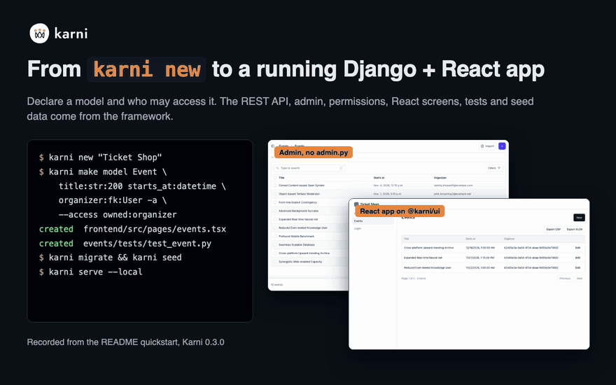
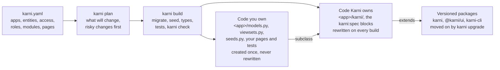

# Karni

Karni is an open-source Django + React framework for building with AI coding
agents. Your agent writes only your domain. The API, admin, permissions and
React screens come from a package you upgrade, not code it rewrites in each
project. One rule set covers every coding agent. The build fails when an
agent hand-writes what Karni ships.

[Quickstart](quickstart.md){ .md-button .md-button--primary }
[Recipes](recipes/index.md){ .md-button }
[GitHub](https://github.com/cbsshekhawat18-lab/karni){ .md-button }

## Why Karni exists

Every web project starts with the same work: sign-in, a user model, the
admin, permissions, CRUD endpoints, tables, forms, Docker and Celery. Coding
agents write that setup faster, but they write it again in every project, a
little different each time. Every line costs tokens and time, and every copy
has to be maintained.

Karni ships that code as versioned packages: `karni` (Python), `@karni/ui`
(React) and the `karni` command. You declare a model and who may access it,
and Karni gives you the REST API, the admin, role-based access, the React
screens, the tests and the demo data. The agent writes only your domain, and
`karni check` fails the build when it hand-writes what Karni ships. Karni
grew out of the 34 projects we built before it.

## Build an app from one line

1. **Create a project** with `karni new "Yoga Studio"` and open it in your coding agent.
2. **Describe the app in one line** after `/new-app`. AGENTS.md tells the agent what that asks for.
3. **The agent writes `karni.yaml`** from the closest [recipe](recipes/index.md), and asks you only the questions `karni plan --questions` lists.
4. **`karni build` makes the app**: modules, Karni's code, migrations, demo data, TypeScript types, the tests and `karni check`.
5. **The agent writes only the domain logic that is left**, in the project's own files. It is done when `karni check` and `karni test` pass.

```text
/new-app a booking app for a yoga studio, with online payments
```

What the agent runs, from a real session:

```text
$ karni recipes list --match "a booking app for a yoga studio, with online payments"
booking   4  Booking: Resources with time slots that members book and pay for, never over capacity. (matched: booking)
shop      3  Online shop: Products in categories, a cart, orders and checkout with online payments. (matched: online, payment)

$ karni build
...
22 changes, 0 risky.
modules     karni add payments
migrations  bookings/migrations/0001_initial.py
migrate     applied 84 on default
seed        Resource 4, Slot 30, Booking 60 (demo login demo@example.com / karni-password)
types       frontend/src/api/types.ts and hooks.ts
test        7 passed in 2.09s, tests/openapi.snapshot.json updated (the API changed: commit it)
check       ok
Built: the project matches karni.yaml.
```

[The /new-app flow](agents.md#agents-the-new-app-flow) has every step.
Every step is also a command you can run without an agent
([building without one](guide/without-ai.md)).

{ loading=lazy }

## Fewer tokens, less time

<!-- bench:home:start -->
!!! note "The measurement is in progress"
    A coding agent is building the same three apps five times with Karni and
    five times without it. This section shows the results when the runs are
    done, and no numbers before then.
<!-- The table the results drop into, from benchmarks/tokens.md:

| App | Tokens, without Karni | Tokens, with Karni | Time, without | Time, with | Success, without | Success, with |
|---|---|---|---|---|---|---|
| Booking with payments | | | | | | |
| A CRM with three roles and import | | | | | | |
| A shop with orders and refunds | | | | | | |
-->
<!-- bench:home:end -->

The same agent and model build each app from the same prompt and API
contract, on plain Django + React or on a new Karni project, and the
harness's own acceptance tests decide success. The
[token benchmark](benchmarks/tokens.md) has the method, the limits and the
raw data.

## What you get

<div class="grid cards" markdown>

-   **Start fast**

    ---

    [`karni new`](quickstart.md), six [recipes](recipes/index.md), the
    [app spec](app-spec.md) with `karni plan` and `karni build`,
    [demo data](seeding.md) and [real content](content-loading.md), and a
    [public website](public-site.md) next to the app.

-   **Data and access**

    ---

    [`BaseModel`](models.md), [typed fields](fields.md),
    [states and capacity](lifecycle-and-capacity.md), [`BaseViewSet`](api.md)
    with a required `access` rule, [accounts and roles](accounts.md) and
    [change history](change-history.md).

-   **Large apps**

    ---

    [Aggregations](aggregations.md), [search across models](global-search.md),
    [navigation from data](navigation.md),
    [trees and taxonomies](models.md#tree-models),
    [import and export](import-export.md) and
    [tooling for 100 models or more](large-projects.md).

-   **Admin**

    ---

    [An admin for every model](admin.md) with no `admin.py`: derived columns,
    filters, pagination, bulk edit, [row scope](admin.md#row-scope) and a
    [permission matrix](admin.md#permission-matrix).

-   **UI**

    ---

    [`ResourceTable`, `ResourceForm`, `ResourceDetail`](ui.md) from the
    OpenAPI schema, sign-in pages, the app shell, and
    [your design system's look](theming.md).

-   **Modules**

    ---

    Payments, approvals, impersonation, a public site,
    [charts](charts.md), [PDF reports](reports.md),
    [extraction](ai-extraction.md) and [protected files](storage.md), each
    added with [one command](modules.md).

-   **Coding agents**

    ---

    [AGENTS.md](agents.md#agentsmd) from one rule set, `karni context`, the
    [MCP server](agents.md#mcp), [`karni check`](enforcement.md) and the
    [debugging commands](debugging/why.md).

-   **Production**

    ---

    [A production Docker Compose stack](deploy.md) with Caddy and TLS,
    [safe defaults](security.md), [one-line tests](testing.md) and
    [`karni upgrade`](stability.md).

</div>

[Every feature, with its status](features.md){ .md-button }

## Recipes and modules

| Recipe | What it gives | One command |
|---|---|---|
| [`shop`](recipes/shop.md) | Products in categories, a cart, orders, checkout with online payments | `karni new "Corner Shop" --recipe shop` |
| [`booking`](recipes/booking.md) | Resources with time slots that members book and pay for, never over capacity | `karni new "Yoga Studio" --recipe booking` |
| [`crm`](recipes/crm.md) | Companies, contacts and deals in a pipeline, with two-factor sign-in | `karni new "Sales Desk" --recipe crm` |
| [`lms`](recipes/lms.md) | Courses with lessons in order, enrolments and each student's progress | `karni new "Course Hub" --recipe lms` |
| [`marketplace`](recipes/marketplace.md) | Sellers, listings, orders and the payout after the fee | `karni new "Market Hall" --recipe marketplace` |
| [`data-portal`](recipes/data-portal.md) | Datasets and indicators by region and sector, with saved charts | `karni new "Data Portal" --recipe data-portal` |

| Module | What it gives | One command |
|---|---|---|
| `karni-payments` | Hosted checkout, refunds and signature-verified webhooks for Stripe and Razorpay, with a test provider for CI | `pip install karni-payments && karni add payments` |
| `karni-approvals` | A second person approves high-value changes before they are written, with a queue and an audit trail | `pip install karni-approvals && karni add approvals` |
| `karni-impersonation` | Safe "log in as user" for support staff: a banner, a time limit, both identities in the audit trail | `pip install karni-impersonation && karni add impersonation` |
| [`karni-site`](public-site.md) | A public website whose every text, image and menu is editable in the admin, with forms and redirects | `pip install "karni-site[images]" && karni add site` |
| [`karni-charts`](charts.md) | Charts defined and previewed in the admin, served under each resource's access | `pip install karni-charts && karni add charts` |
| [`karni-reports`](reports.md) | A row printed to PDF from an HTML template in the background, served only to users who may see the row | `pip install karni-reports && karni add reports` |
| [`karni-ai`](ai-extraction.md) | Rows for any resource read from text, a web page or a PDF by a language model, always through the import preview | `pip install "karni-ai[<provider>]" && karni add ai` |
| [`karni-storage`](storage.md) | Files a row owns, in S3 or an S3-compatible service, served only to whoever may read the row | `pip install "karni-storage[images]" && karni add storage` |

## Quickstart

You need Python 3.12 or later and Node 20.19 or later. This runs the shop
recipe on SQLite, with no Docker:

```sh
python3 -m venv .venv && . .venv/bin/activate
pip install karni karni-cli karni-payments pytest pytest-django
karni new "Corner Shop" --recipe shop && cd corner_shop
printf 'DATABASE_URL=sqlite:///data/db.sqlite3\nKARNI_CACHE=locmem\n' > .env
karni build
karni serve --local
```

Then, in a second terminal: `cd corner_shop/frontend && npx --yes npm@11 install && npm run dev`.
The [quickstart guide](quickstart.md) does the same on PostgreSQL, Karni's
default database.

## How it works



The code you own subclasses what Karni writes. For one resource it is a model
and a viewset:

```python
class Venue(BaseModel):
    name = models.CharField(max_length=200)
    city = models.CharField(max_length=100)
    capacity = models.IntegerField()


class VenueViewSet(BaseViewSet):
    model = Venue
    access = Access(read=Public(), write=HasRole("organizer", "staff"))
    search_fields = ("name", "city")
```

From those two classes Karni derives the endpoints at `/api/venues/`, the
OpenAPI schema and a typed client, the admin screen, the permission checks
on every query, and a table, form and detail view in React
([what Karni owns, and what the project owns](app-spec.md#what-karni-owns-and-what-the-project-owns)).

## Questions

Karni is not production-ready yet: it has two reference applications and CI
on every push, but no known production deployment. The
[FAQ](faq.md) answers that and more, the [stability promise](stability.md)
says what an upgrade may change, and Karni is open source under the Apache
License 2.0.
